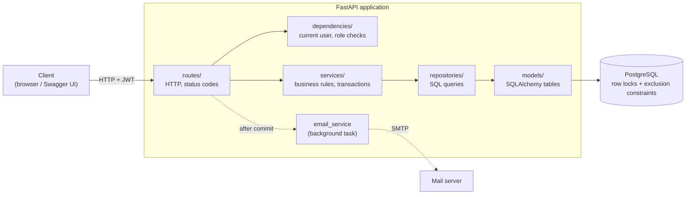
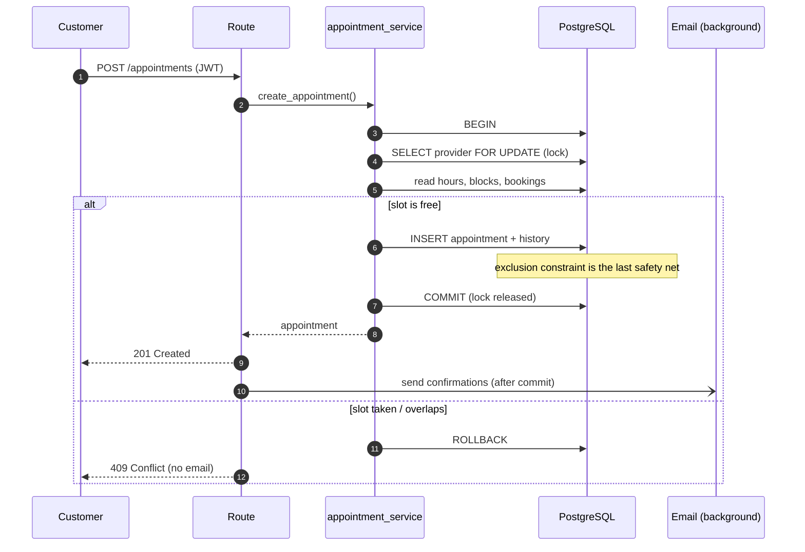

# Architecture

SlotBook is a **modular monolith**: one FastAPI application with clear internal layers, one PostgreSQL database.
No microservices, queues or caches are needed for this scope.

## Layers

| Layer | Responsibility |
| --- | --- |
| `routes/` | HTTP endpoints, request parsing, response codes |
| `dependencies/` | Resolve the current user from the JWT, enforce roles |
| `schemas/` | Pydantic request/response models (validation, no password hashes in responses) |
| `services/` | Business rules: slot validation, booking lifecycle, availability, stats, notifications |
| `repositories/` | Database queries only |
| `models/` | SQLAlchemy tables and database constraints |
| `core/` | Settings, password hashing, JWT, login rate limiter |
| `database/` | Session, `transaction()` helper, DB-error to HTTP-error translation |

## Booking a slot

Two simultaneous requests for the same slot queue on the provider lock; the second one then sees the first
booking and gets 409. See [concurrency.md](concurrency.md).

## Key decisions

- **PostgreSQL**: relational data, foreign keys, transactions, row locks and exclusion constraints.
- **Two layers against double booking**: application lock (clear to explain) + database constraint (cannot be bypassed).
- **Email after commit, never inside the transaction**: a mail failure cannot undo or block a booking; it is logged.
  A future outbox table + worker could retry failed sends.
- **UTC everywhere**: clients send timezone-aware timestamps; each provider has an IANA timezone for working hours.
- **Stateless auth**: short-lived JWT bearer tokens; no server-side sessions.
