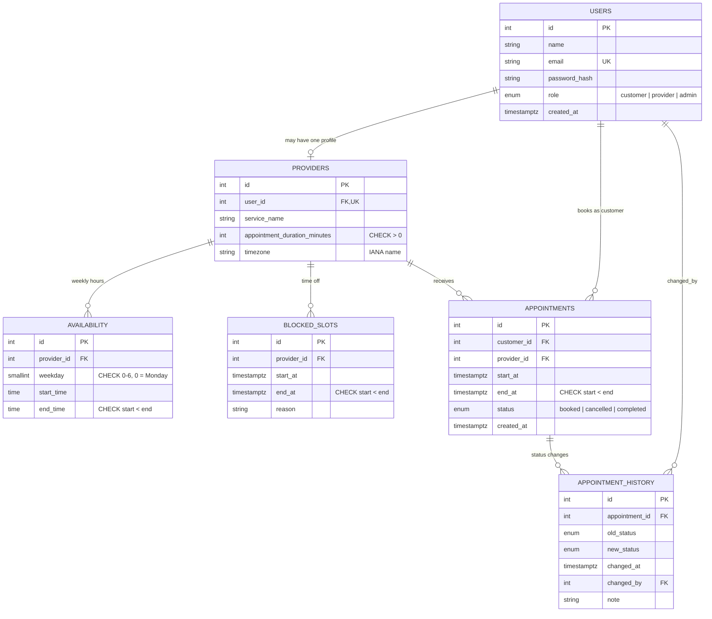

# Database design

Exclusion constraints (not drawn above): `appointments` has no overlapping **booked** rows per provider;
`availability` has no overlapping hours per provider and weekday. Details below.

| Table | Fields |
| --- | --- |
| users | id, name, email (unique), password_hash, role, created_at |
| providers | id, user_id (FK, unique), service_name, appointment_duration_minutes, timezone |
| availability | id, provider_id (FK), weekday (0=Mon), start_time, end_time |
| blocked_slots | id, provider_id (FK), start_at, end_at, reason |
| appointments | id, customer_id (FK), provider_id (FK), start_at, end_at, status, created_at |
| appointment_history | id, appointment_id (FK), old_status, new_status, changed_at, changed_by, note |

Rules: store timestamps in UTC; validate start < end; cancelled appointments do not block slots.

## Database-enforced constraints

| Constraint | Table | Rule |
| --- | --- | --- |
| `ck_providers_duration_positive` | providers | `appointment_duration_minutes > 0` |
| `ck_availability_weekday_range` | availability | `weekday BETWEEN 0 AND 6` |
| `ck_availability_start_before_end` | availability | `start_time < end_time` |
| `ex_availability_no_overlap` | availability | no overlapping hours for one provider on one weekday (touching is allowed) |
| `ck_appointments_start_before_end` | appointments | `start_at < end_at` |
| `ex_appointments_no_overlap` | appointments | no overlapping **booked** appointments for one provider (cancelled ignored, back-to-back allowed) |
| `ck_blocked_slots_start_before_end` | blocked_slots | `start_at < end_at` |

The exclusion constraints need the PostgreSQL `btree_gist` extension (created by the first Alembic migration).
Pydantic validates the same rules at the API edge (clear 422 errors); the database constraints are the safety net.

## Migrations
Managed with Alembic (`backend/migrations`). See `backend/README.md`.
<<<<<<< HEAD
=======

TODO: add an ER diagram.
>>>>>>> 1b166ad1a412ecd604ed83ea617b5aa4eb056234
